  

 

  

📫 **Discover My Work**: [abhishekdp.com](https://abhishekdp.com)

## Stats

  
  
  
  

 

## Contribution City

<picture>
  <source media="(prefers-color-scheme: dark)" srcset="https://raw.githubusercontent.com/abhishek-1804/abhishek-1804/output/profile-night-rainbow.svg" />
  <source media="(prefers-color-scheme: light)" srcset="https://raw.githubusercontent.com/abhishek-1804/abhishek-1804/output/profile-green-animate.svg" />
  
</picture>

<picture>
  <source media="(prefers-color-scheme: dark)" srcset="https://raw.githubusercontent.com/abhishek-1804/abhishek-1804/output/github-contribution-grid-snake-dark.svg" />
  <source media="(prefers-color-scheme: light)" srcset="https://raw.githubusercontent.com/abhishek-1804/abhishek-1804/output/github-contribution-grid-snake.svg" />
  
</picture>
